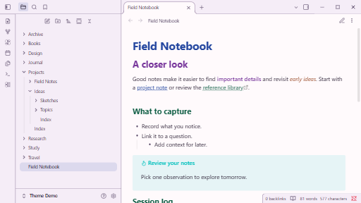

# Color Notes

An Obsidian theme with useful semantic colours and polished defaults.

Source version 3.4.1. The theme supports light and dark modes and requires Obsidian 1.15.1 or later. The preview screenshots were captured in Obsidian 1.15.1 on Windows.

## Preview

## Install manually

1. Download `manifest.json` and `theme.css` from [the latest GitHub release](https://github.com/tutivsoft-com/obsidian-theme-color-notes/releases/latest).
2. Put both files in `.obsidian/themes/Color Notes/` in your vault.
3. Open **Settings > Appearance** and select **Color Notes**. Choose a supported base colour scheme.

## Check the source

With Python 3.9 or later and `tinycss2` installed, run `python -B -m unittest -v` from the repository root. The tests check stylesheet structure, link and text contrast in both modes, mobile editor padding, and version metadata.

See the [original design plan](PLAN.md). [MIT license](LICENSE).
